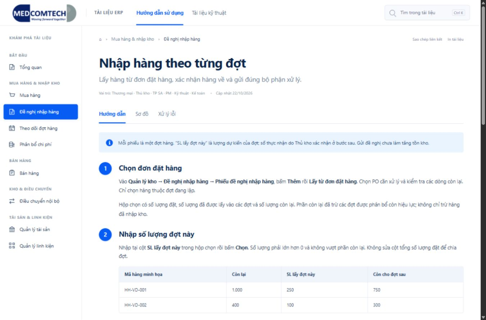

# MEDCOM ERP — Trung tâm tài liệu

Web tĩnh HTML/CSS/JavaScript. Không cần đăng nhập, backend, DB hoặc bước cài thư viện để xem. Header và sidebar theo mẫu C; nội dung dạng bước thao tác theo mẫu B, không có mục lục bên phải.



[Xem bố cục điện thoại](preview/mobile.png)

## Hai đường dẫn

- `HDSD-ERP/`: hướng dẫn cho người dùng, sơ đồ và xử lý lỗi.
- `TLKT/`: luồng kỹ thuật, khóa liên kết, form, STP, view, function và trigger.
- Cùng một mã bài ở hai khu vực, ví dụ `HDSD-ERP/#inbound` và `TLKT/#inbound`. Gửi đường dẫn HDSD cho khách hàng và đường dẫn TLKT cho đội phát triển; giao diện không có tab chuyển giữa hai khu vực.
- Nội dung và tìm kiếm được tạo riêng cho từng khu vực. HDSD không tải bài kỹ thuật, danh sách form/SQL hoặc trả kết quả dẫn sang TLKT; logo và các liên kết bài giữ người đọc trong khu vực đang mở.
- Liên kết đến sơ đồ: `HDSD-ERP/#internal-transfer/flow`.

9 bài gồm tổng quan và 8 quy trình, tổng hợp từ đủ 7 tài liệu Word được cung cấp. BPTM được tách thành mua hàng và theo dõi đợt hàng/thanh toán. Chỉ rõ các thay đổi đã đối chiếu tại [RECONCILIATION.md](RECONCILIATION.md); nguồn metadata đã loại dữ liệu nghiệp vụ nằm trong [content/evidence.json](content/evidence.json).

## Xem tại máy

Node.js 20 trở lên, không cần `npm install`:

```text
cd src/helps
npm run dev
```

Mở `http://127.0.0.1:4173/HDSD-ERP/`. Có thể đặt biến `HELPS_PORT` nếu cổng đang dùng. Cũng có thể mở trực tiếp `HDSD-ERP/index.html`; sơ đồ nên xem qua HTTP để trình duyệt tải tài nguyên nhất quán.

## Cập nhật tài liệu

1. Sửa bài trong `content/guides/` hoặc `content/technical/`; các tệp cùng tên thuộc cùng quy trình.
2. Sửa `content/catalog.json` khi đổi tiêu đề, vai trò, lỗi thường gặp, sơ đồ Mermaid hoặc thêm bài. Giữ ID ổn định để liên kết cũ còn dùng được.
3. Chỉ dùng các định dạng Markdown được hỗ trợ: `##`, `###`, đoạn văn, danh sách `-`, bảng, `**đậm**`, mã trong backtick, liên kết bài `#id` và ghi chú `>`. HTML nguồn được hiển thị như văn bản, không thực thi.
4. Sau khi đối chiếu ERP/DB, cập nhật ngày review và bằng chứng liên quan. Không tự nâng ngày kiểm chứng khi chỉ chỉnh chính tả.
5. Chạy:

```text
npm run build
npm test
```

6. Commit cả nguồn, `assets/content.generated.js` (HDSD), `assets/technical.generated.js` (TLKT) và các trang `index.html` được tạo lại. Push/merge bản đã kiểm tra rồi triển khai lại thư mục web. Website hiển thị nội dung bản đang triển khai; không tự đọc phiên bản mới trên GitHub khi máy chủ chưa nhận bản đó.

Tệp sinh sẵn giúp web không phải tải Markdown bằng fetch và có thể hoạt động trên hosting tĩnh. Không sửa trực tiếp tệp sinh sẵn. Thư viện Mermaid 12.2.0 được đặt cục bộ, có giấy phép và hash trong `assets/vendor/`; không tải CDN lúc người dùng mở sơ đồ.

## Đưa lên máy chủ

Phục vụ **toàn bộ** `src/helps` làm một gốc web tài liệu; giữ nguyên vị trí tương đối của `assets/`, `HDSD-ERP/`, `TLKT/` và `content/`. Nếu gốc này ở `https://zmc.bms79.com/`, hai địa chỉ sẽ là:

- `https://zmc.bms79.com/HDSD-ERP/`
- `https://zmc.bms79.com/TLKT/`

Nếu máy chủ đã có ứng dụng ở gốc, người vận hành cần ánh xạ hai đường dẫn trên **và thư mục assets dùng chung** đến đúng nơi; không chép đè tài nguyên của ứng dụng hiện hữu. Một lựa chọn khác là đặt cả thư mục dưới `/erp-docs/`; tất cả liên kết tương đối vẫn chạy. Không cần rewrite cho ID bài vì dùng phần `#` của URL.

Cho phép MIME HTML, JS, CSS, SVG và JSON. HTML và cả hai tệp `*.generated.js` nên revalidate mỗi lần mở (Cache-Control: no-cache); các tài nguyên thư viện có version có thể cache dài. Sau cập nhật, kiểm tra bài, tab sơ đồ và tìm kiếm trên đường dẫn triển khai thật.

Trong lượt này chỉ đưa mã và nội dung lên nhánh/PR của repo; **chưa thay cấu hình máy chủ hay triển khai lên tên miền**.

## Phạm vi kiểm chứng

- Đọc đủ 7 Word; đối chiếu cấu hình form/menu và định nghĩa SQL hiện tại bằng phiên chỉ đọc ngày 22/10/2026.
- Kiểm tra trực quan một số màn hình bằng Admin; không thực hiện gửi/duyệt/chốt chứng từ để thử và không đăng nhập các vai trò khác.
- Không sửa quyền, dữ liệu hay logic ERP trong công việc tài liệu này.
- Kiểm tra tự động nguồn nội dung, liên kết, tìm kiếm không dấu, chặn HTML/link nguy hiểm, tài nguyên tĩnh và hash thư viện; kiểm tra trình duyệt được ghi riêng trong bảng đối chiếu.

Nguồn Word, ảnh màn hình chứa khách hàng, bản xuất dữ liệu/SQL đầy đủ và thông tin kết nối không thuộc repo công khai. Ví dụ trên web là dữ liệu minh họa. Phần kỹ thuật và Markdown là nguồn đọc cho cả dev và AI; không dùng trang web để thực thi nghiệp vụ trên ERP.
